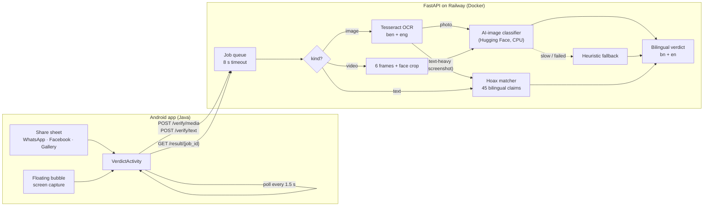

# Jachai (যাচাই): AI-generated content & hoax detector

Android share-sheet app + FastAPI backend for the AI Congress 2026 Buildfest.
Share a photo, video or message to **Jachai** → full-screen **Red** (fake / known hoax) or **Green** verdict, in Bengali and English.

```
android/   Native Java app (min SDK 24): share-sheet entry point, verdict screen, floating bubble
backend/   FastAPI service: /verify/media, /verify/text, /result/{job_id}, /health
docs/      API_CONTRACT.md (locked Day 1), DEMO.md (stage runbook)
```

## Architecture



## Status against the 5-day plan

| Day | Deliverable | State |
|---|---|---|
| 1 | 4 contract endpoints + mock mode | ✅ tested |
| 1 | Share-sheet intake (`image/*`, `video/*`, `text/plain`), Red/Green verdict screen, Retrofit client | ✅ tested on a real phone (Android 15) |
| 1 | Deployed on Railway | ✅ `jachai-api-production.up.railway.app` |
| 2 | Image + video pipeline: OpenCV, face crop, `Ateeqq/ai-vs-human-image-detector` (picked by `scripts/compare_models.py`, 9/9 on samples, threshold 0.75) | ✅ ~0.3 s/image on CPU. Small sample; no deepfake video tested yet |
| 2 | Heuristic fallback + 8 s server-side timeout | ✅ tested |
| 3 | OCR (Tesseract ben+eng) + UI-chrome cleaning | ✅ working on Railway |
| 3 | 45-entry bilingual hoax DB + fuzzy matcher | ✅ calibrated: hoaxes ≥ 0.63, real news ≤ 0.47, threshold 0.58. Facts need fact-checker review |
| 4 | Verdict UI: icon, stacked bn/en verdict, explanation, animated confidence bar, haptics, **Share result** | ✅ |
| 4 | Bilingual app (`values` / `values-bn`), follows device locale, manual toggle | ✅ |
| 4 | Splash screen, colour system (Red #C0392B / Green #1E8449), dark mode, friendly error states | ✅ |
| 4 | Floating bubble (SYSTEM_ALERT_WINDOW + MediaProjection) → `/verify/media` | ✅ built, needs hands-on test |
| 5 | Release APK, pre-warm script, demo runbook | ✅ see [docs/DEMO.md](docs/DEMO.md) |

## Backend

```powershell
cd backend
python -m venv .venv
.venv\Scripts\pip install -r requirements-dev.txt
# real model (otherwise heuristics):
.venv\Scripts\pip install torch --index-url https://download.pytorch.org/whl/cpu
.venv\Scripts\pip install -r requirements-ml.txt

.venv\Scripts\python -m pytest -q                              # 34 tests
.venv\Scripts\uvicorn app.main:app --host 0.0.0.0 --port 8000
```

| Script | Use |
|---|---|
| `scripts/compare_models.py ../samples` | Compare candidate detectors on `samples/real` + `samples/fake` |
| `scripts/calibrate.py ../samples --url <server>` | Score samples against a running server, suggest `FAKE_THRESHOLD` |
| `scripts/benchmark_model.py` | Model load time + CPU latency |
| `scripts/add_override.py <file> red\|green [--hoax-id ID]` | Pin a rehearsed demo file's verdict (by SHA-256) |
| `scripts/prewarm.py [--image FILE]` | Wake the server and exercise each path before going on stage |

Tunables are environment variables; see `backend/.env.example`. The important ones:

- `MOCK_MODE=true` gives the Day 1 behaviour: a fixed job id and alternating red/green.
- `ENABLE_ML=false` uses the heuristic scorer only, which is cheap on memory.
- `FAKE_THRESHOLD` and `HOAX_THRESHOLD` are the verdict cut-offs.

### Deploy (Railway)

GitHub repo → Railway *Deploy from repo* → **Root Directory `backend`** → *Generate Domain*. The Dockerfile installs Tesseract with Bengali and bakes the model into the image. The model needs about 1–1.5 GB RAM.

## Android

Build from the command line (Android Studio's bundled JDK):
```powershell
$env:JAVA_HOME = "C:\Program Files\Android\Android Studio\jbr"
cd android
.\gradlew.bat assembleRelease     # app/build/outputs/apk/release/app-release.apk
```
The backend URL is baked in from `android/local.properties` (`api.baseUrl=https://…/`) and can be changed at runtime on the home screen. The release build is signed with the debug key so it installs without extra setup; that's fine for a demo but not for the Play Store.

Floating bubble on Xiaomi/HyperOS: also enable *Settings → Apps → Jachai → Other permissions → Display pop-up windows while running in the background*.

## Business model (draft for the team to confirm)

- **Free:** anyone can check photos, videos and messages from the share sheet.
- **Family safety bundle, 50 BDT/month:** covers a family's phones (e.g. parents and grandparents who receive the most forwarded rumours).
- **Channel:** mobile-operator billing / MFS (bKash, Nagad), so no card is needed.

## Roadmap beyond the demo

- Perceptual-hash cache for viral media, so the same forwarded video is analysed once.
- Fine-tuned deepfake classifier on Bangladeshi-context media.
- Crowdsourced hoax database with a moderation pipeline, fed by fact-checkers.
- Payment integration for the family bundle.

## Before the pitch

- Check every `fact_en`/`fact_bn` line in `backend/data/hoaxes.json` against a Bangladeshi fact-checker (Rumor Scanner, Dismislab, AFP Fact Check Bangla) and add source links. Then run `pytest tests/test_matcher_calibration.py`.
- Check the detector model's licence on its Hugging Face page.
- Follow [docs/DEMO.md](docs/DEMO.md).
